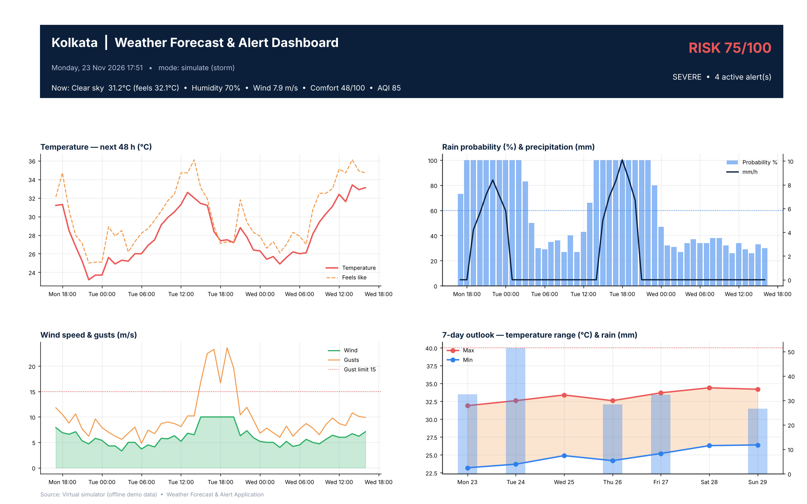
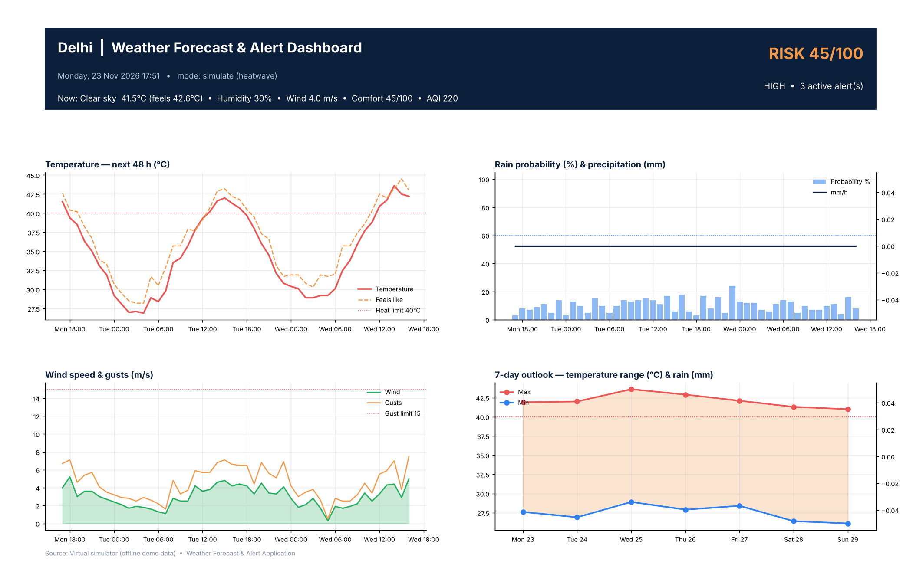
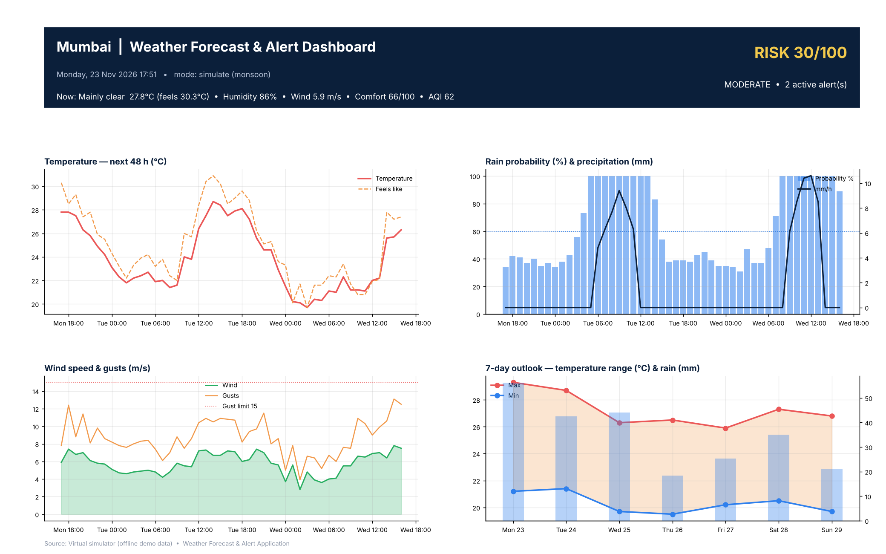
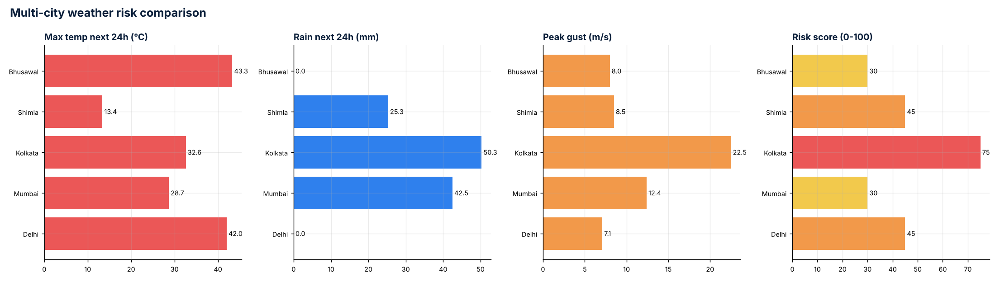

# ⛅ Weather Forecast & Alert Application

> A modular Python system that fetches real-time and forecast weather, runs a **rule-based alert engine** (rain, heat, wind, storm, UV, fog, cold, AQI), computes a **0–100 risk score**, serves everything through a **FastAPI** service, and visualises it in a **Streamlit** dashboard, with Telegram/Email notifications and CSV/TXT/HTML reports.

Works with the free **Open-Meteo** API (**no API key needed**) *and* with a built-in **offline virtual simulator**, so you can demo it anywhere.



## 🎯 Problem Statement
Weather decisions are made manually and too late. Logistics, farming, events, energy and public-safety teams need **automatic, explainable warnings** ("Gusts 23 m/s around Tue 18:00 – secure loose objects") rather than raw numbers.

## 🏭 Industry Relevance
| Sector | How this project maps |
|---|---|
| Logistics | Rain/wind/fog alerts → reroute or delay shipments |
| Agriculture | Heat/cold/rain windows → irrigation & spraying decisions |
| Energy | Wind/UV/heat → solar & grid planning, maintenance windows |
| Events & travel | "Best outdoor window" finder, storm warnings |
| Public safety | Heat-index, AQI, thunderstorm advisories |

Skills demonstrated: **API integration, data normalisation (Pandas), rule engine, SQL storage, REST API design, scheduling, alert de-duplication, data visualisation, testing.**

## ✨ Features
- 🌍 Live data (Open-Meteo, no key) **or** deterministic offline simulation with 7 scenarios (`normal, heatwave, monsoon, storm, fog, cold, auto`)
- 🚨 **11 alert rules** with severity (`info / warn / critical`), numbers, time window and **recommended action**
- 📊 **Risk score 0–100** and **comfort index**; **best outdoor window** finder; optional **AQI** alerts
- 🔔 Telegram + Email notifications with **12-hour de-duplication** (dry-run in simulation)
- 🗄️ SQLite store (raw JSON provenance + normalised hourly/daily + alert log)
- 🌐 FastAPI endpoints with auto docs at `/docs`; optional background refresh
- 🖥️ Streamlit dashboard: KPI cards, interactive charts, map, multi-city comparison, CSV/HTML export
- 📄 Reports: CSV, TXT, JSON, standalone HTML (charts embedded) + PNG charts
- 🛡️ Robust: retry/back-off, missing-value tolerant, **automatic fallback to simulation** if the API is unreachable
- ✅ Pytest suite (rule tests, golden scenarios, storage, de-dupe, mocked live API)

## 🧱 Tech Stack
Python 3.10+ · requests · pandas · numpy · matplotlib · SQLite · FastAPI + Uvicorn · Streamlit + Plotly · python-dotenv · pytest · Docker

## 🗂️ Architecture
```
 City ─► Geocode ─► Provider (Open-Meteo | Simulator) ─► normalize() ─► SQLite (raw + hourly + daily)
                                                             │
                                  ┌──────────────────────────┤
                                  ▼                          ▼
                          Rule Engine (alerts)        Analysis (pandas)
                                  │                          │
                                  └────────► Snapshot ◄──────┘
                                                │
        ┌──────────────┬────────────────┬───────┴───────┬──────────────┐
        ▼              ▼                ▼               ▼              ▼
     CLI main.py   FastAPI /docs   Streamlit UI    Reports/Charts   Notifier (Telegram/Email)
```

## 📁 Folder Structure
```
Weather-Forecast-Alert-Application/
├── main.py                # CLI entry point
├── src/                   # config, providers, simulator, rules, analysis, storage, notifier, charts, report, service
├── api/app.py             # FastAPI service
├── dashboard/             # Streamlit dashboard (theme in .streamlit/config.toml)
├── jobs/refresh.py        # scheduled refresh (cron / Task Scheduler)
├── db/schema.sql          # SQLite schema
├── tests/                 # pytest suite
├── data/                  # sample/static data
├── outputs/               # generated CSVs + charts (sample outputs included)
├── reports/               # generated TXT / HTML / JSON reports
├── images/                # screenshots used in this README
├── docs/                  # step-by-step guides, interview prep
├── Dockerfile  requirements.txt  .env.example  .gitignore  README.md
```

## 🚀 Setup
```bash
git clone https://github.com/<your-username>/Weather-Forecast-Alert-Application.git
cd Weather-Forecast-Alert-Application

python -m venv .venv
# Windows:  .venv\Scripts\activate        Mac/Linux:  source .venv/bin/activate
pip install -r requirements.txt

cp .env.example .env      # Windows: copy .env.example .env   (optional - only needed for notifications)
```
**API setup:** the default provider (Open-Meteo) needs **no key**. For notifications, put your own Telegram/SMTP values in `.env` (never commit it – it's in `.gitignore`).

## ▶️ How to Run
```bash
python main.py --city Delhi --simulate                       # offline demo
python main.py --city Mumbai --simulate --scenario monsoon   # force a scenario
python main.py --city London --live                          # real data (internet needed)
python main.py --cities Delhi,Mumbai,Kolkata --simulate      # multi-city comparison chart
python main.py --city Pune --heat 38 --rain 50 --wind 12     # custom thresholds
python main.py --dashboard                                   # Streamlit UI  → http://localhost:8501
python main.py --serve                                       # FastAPI       → http://localhost:8000/docs
python -m jobs.refresh                                       # refresh all saved cities
pytest -q                                                    # run tests
```

## 🖨️ Sample Output
```
  ALERTS (4)
   [CRITICAL] Thunderstorm expected
              Thunderstorm conditions from Tue 15:00 (6 h).
              → Stay indoors, unplug sensitive equipment, avoid open fields and tall trees.
   [WARN    ] Heavy rainfall expected
              51 mm of rain forecast on 2026-11-24.
   [WARN    ] Wind gusts ≥ 15 m/s
              Gusts up to 22.5 m/s (81 km/h) around Tue 16:00.
   [WARN    ] Rain likely in next 12h
              Rain probability peaks at 100% around Mon 18:00.
  RISK SCORE  ███████████████░░░░░ 75/100 — SEVERE   (Kolkata, storm scenario)
```
Full terminal output: [`docs/sample_terminal_output.txt`](docs/sample_terminal_output.txt)

## 🖼️ Screenshots
| Heatwave (Delhi) | Monsoon (Mumbai) |
|---|---|
|  |  |



## 🌐 API
| Method | Endpoint | Purpose |
|---|---|---|
| GET | `/snapshot?city=Pune` | Full computation: current, summary, alerts, risk |
| POST | `/locations?city=Pune` | Save a location & fetch data |
| GET | `/forecast/hourly?location_id=1&hours=24` | Hourly series |
| GET | `/forecast/daily?location_id=1&days=7` | Daily series |
| GET | `/alerts?location_id=1` | Evaluated alerts + risk |
| GET | `/compare?cities=Delhi,Mumbai` | Cities ranked by risk |
| POST | `/refresh` | Re-fetch all saved cities |

## 📚 Learning Outcomes
REST API consumption & error handling · JSON → DataFrame normalisation · unit/timezone handling · designing a testable rule engine · SQL schema design · alert de-duplication · building a REST service · dashboarding · secret management with `.env` · writing tests · documenting a project for GitHub.

## 🔭 Roadmap
Leaflet radar layer · multi-provider ensemble · Twilio SMS/WhatsApp · geofencing (GPS → nearest city) · Google Calendar "rain tomorrow" events · ML temperature nowcasting.

## ⚠️ Disclaimer
Simulation mode produces **synthetic data for demonstration only**. Do not use it for real safety decisions.

## 📄 License
MIT — free to use for learning.
